# Life Ledger Produktübersicht

[English](SHOWCASE.md) · [简体中文](SHOWCASE.zh-CN.md) · [Deutsch](SHOWCASE.de-DE.md) · [Zur deutschen README](../README.de-DE.md)

Life Ledger verbindet tägliche Gewohnheiten, konkrete Planung und ausführliche Reflexion in einem lokalen, selbstbestimmten Arbeitsbereich. Alle Screenshots enthalten ausschließlich fiktive Beispieldaten. Version 3.6 führt ein modulares natives Dashboard ein: anpassbare und einklappbare Blasen-Karten in Heute und Woche, ein Monatsgitter für Gewohnheiten, Wochen-Insights und Haarlinien-Grafiken.

## Desktop

16. Oktober, nur Heute: originale Website-Farben, maximal 1236px Zeichenfläche, quadratische Größen und kompakte Vier-Gewohnheiten-Vorgabe. Die Galerie enthält neue 1920px-/1000px-Belege. Isolierte Webansichten, keine Abnahme einer installierten Mac-App; visuelle Bestätigung steht aus.

**Web-Heute-Raster (18. Oktober):** einrastende Karten, per Ziehen sortierbar, Größen nur wo sich der Inhalt ändert; die Monatskarte zeigt die Stimmung. Fiktive Daten, nur Web. 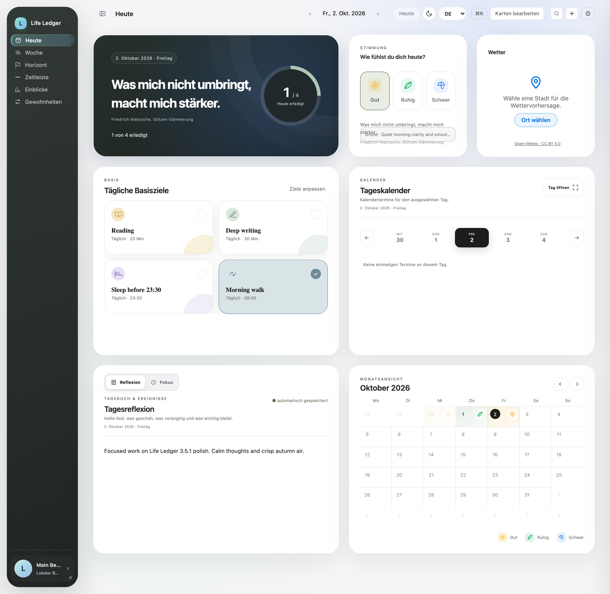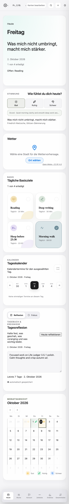

**Heute-Korrektur:** [Echte Standardanordnung, Größen-/Drag-Aufnahme und Prüfungen](local-web/today-repair/index.html). Keine nur für Screenshots gesetzten Positionen. 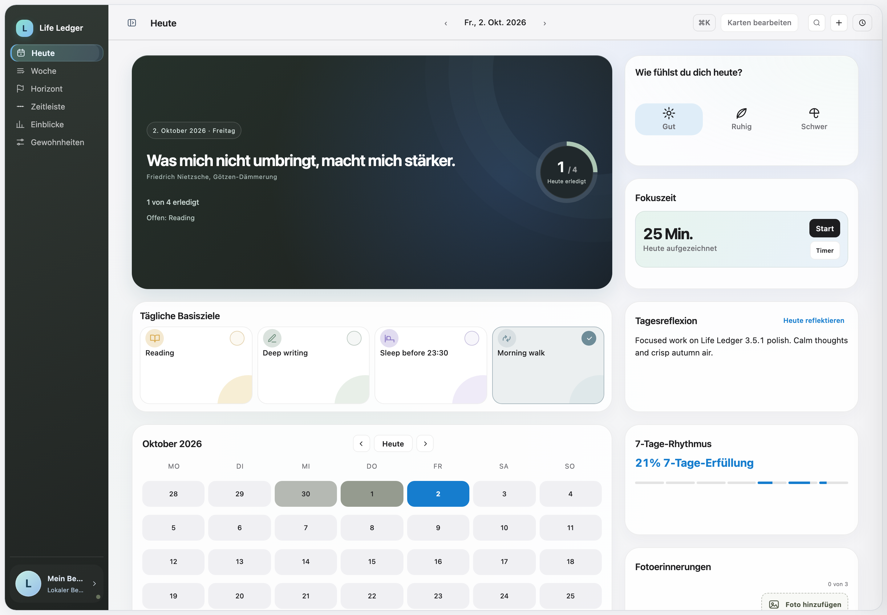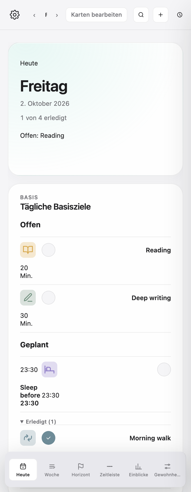

**Korrektur schmaler Fenster:** Bei 800px bleiben Seitenleiste und Inhalt nebeneinander; Aktionen und Datum stehen in getrennten Zeilen. [Desktop](local-web/breakpoints/today-800-de-light.png) · [Mobile Grenze](local-web/breakpoints/today-760-de-light.png) · [Regression](local-web/breakpoints/results.json). Isolierte Browserprüfung, keine Abnahme einer installierten macOS-App.

**Echte lokale Website:** Nach `npm run preview:local` [direkt ausprobieren](http://127.0.0.1:43117/?mode=local&lang=de&preview=local). Gemeinsame Seiten/Karten mit Tauri, keine simulierte native Titelleiste. [Aufnahme und Prüfung](local-web/index.html). Nur die Bilder nutzen fiktive Daten; die lokale App speichert getrennte Browserdaten.

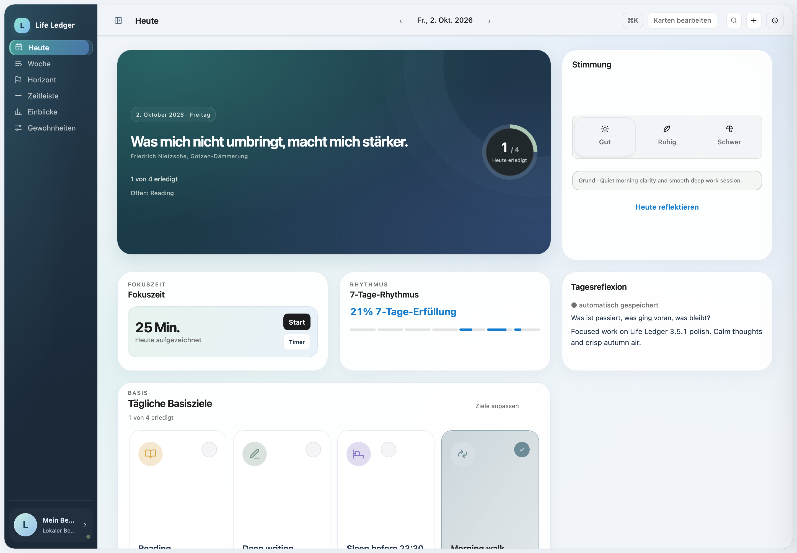
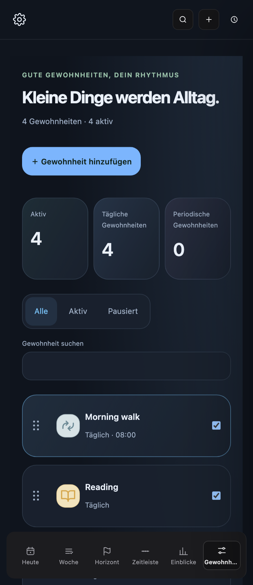

**Integrierter Fensterrahmen:** [Aufnahme und Prüfung](integrated-shell/index.html). Einheitliche Titelleiste, abgerundeter Rahmen, einklappbare Navigation und lokale Profileinstellungen. Native macOS-Knöpfe werden in Chromium nicht imitiert; nicht paketiert oder installiert.

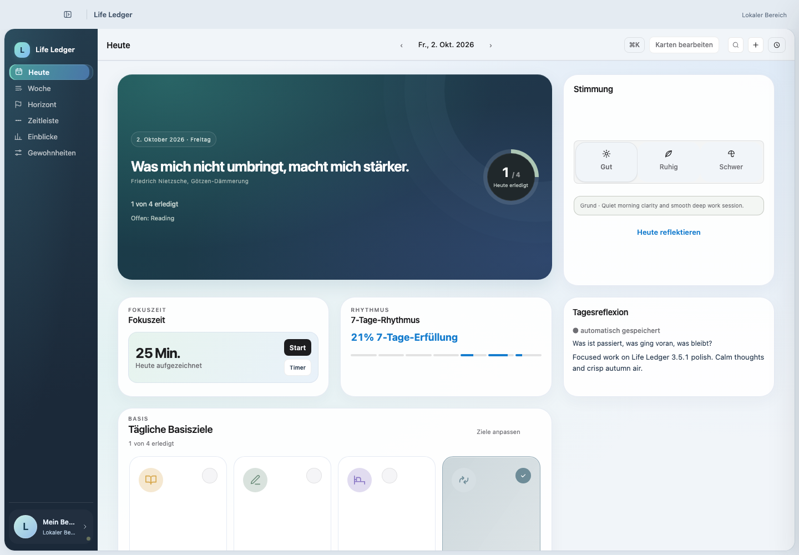
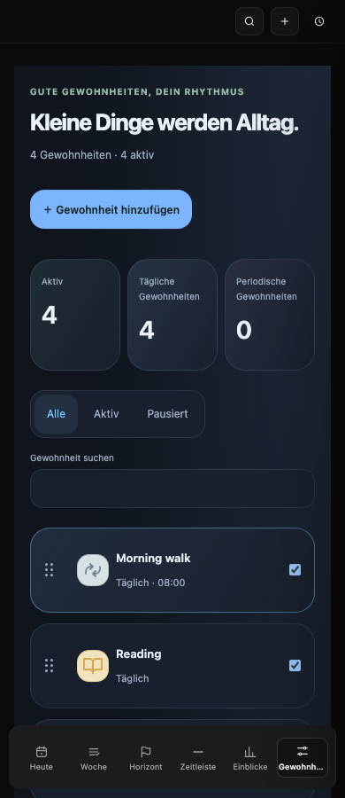

**Horizont / Gewohnheiten:** [Aufnahme und Vergleich](horizon-habits/index.html). Angehefteter Phasenfokus, datierte Planschritte, Archiv-Momentaufnahmen, Monatsrückblick und einheitliche Gewohnheitsbibliothek. Vorhandene Daten/Symbole bleiben; fiktive Beispiele, nicht installiert.

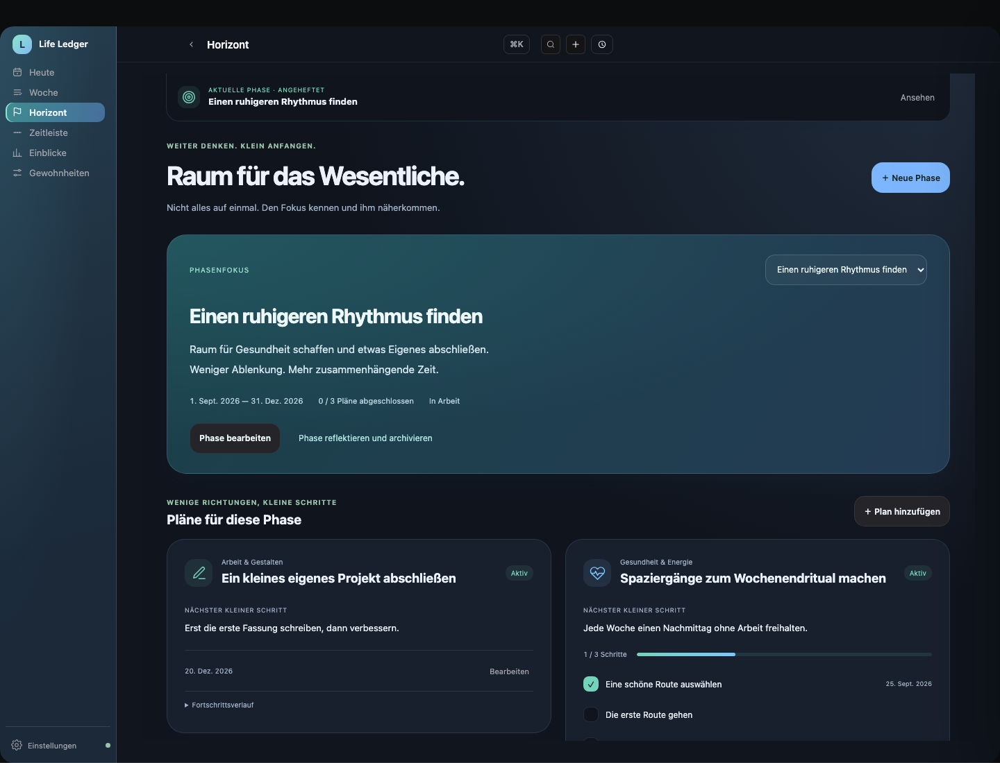
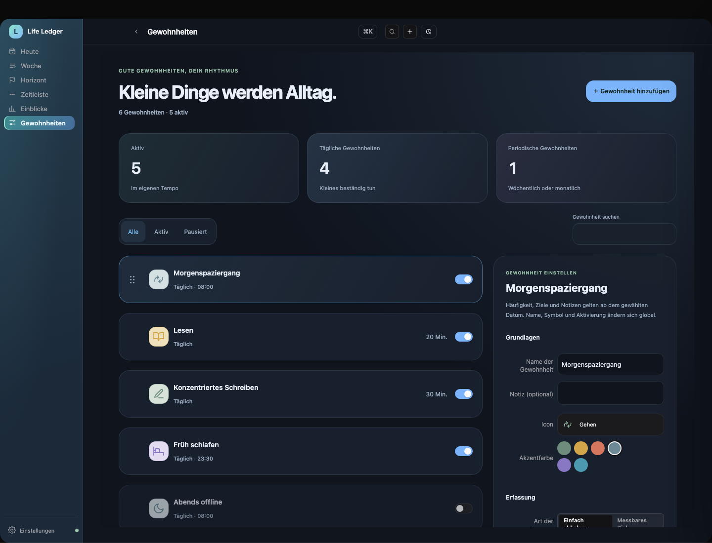

**Zeitleiste / Einblicke:** [Aufnahme und Vergleich](timeline-insights/index.html). Tages-, Wochen- und Monatsansicht auf einer vertikalen Achse, Texte zuerst und Wochenfotos auf Wunsch. Einblicke zeigen Erfassung, erkundbare Trends, vorhandene Gewohnheitssymbole und separate Periodenziele. Fiktive Daten; Bestätigung ausstehend, nicht installiert.

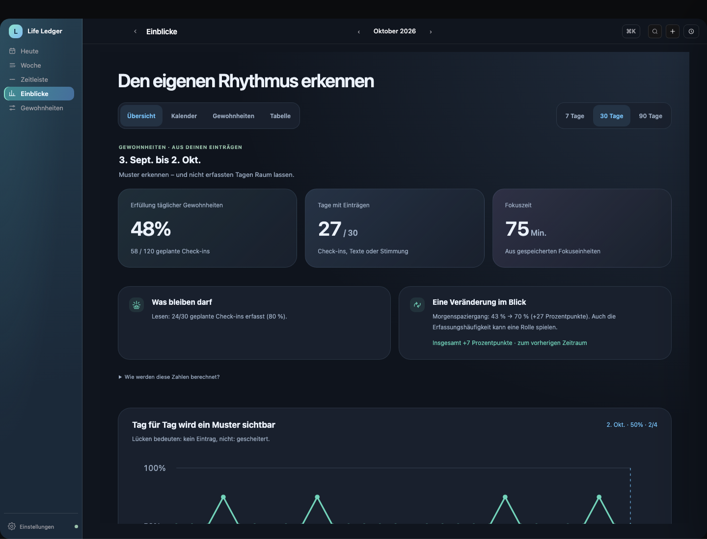

**Aktueller Woche-/Zeitleiste-Prüfstand:** [Aufnahme und Sprachvergleich](week-reflection/index.html). Wochenreflexion, schreibgeschützter Wochenkalender, Einblicke und Ziele; Zeitleiste mit Wochentexten und passenden Fotos. Begrüßung fest breit, Stimmung klein und quadratisch. Fiktive Kalender-/Bilddaten, noch nicht installiert oder visuell bestätigt.

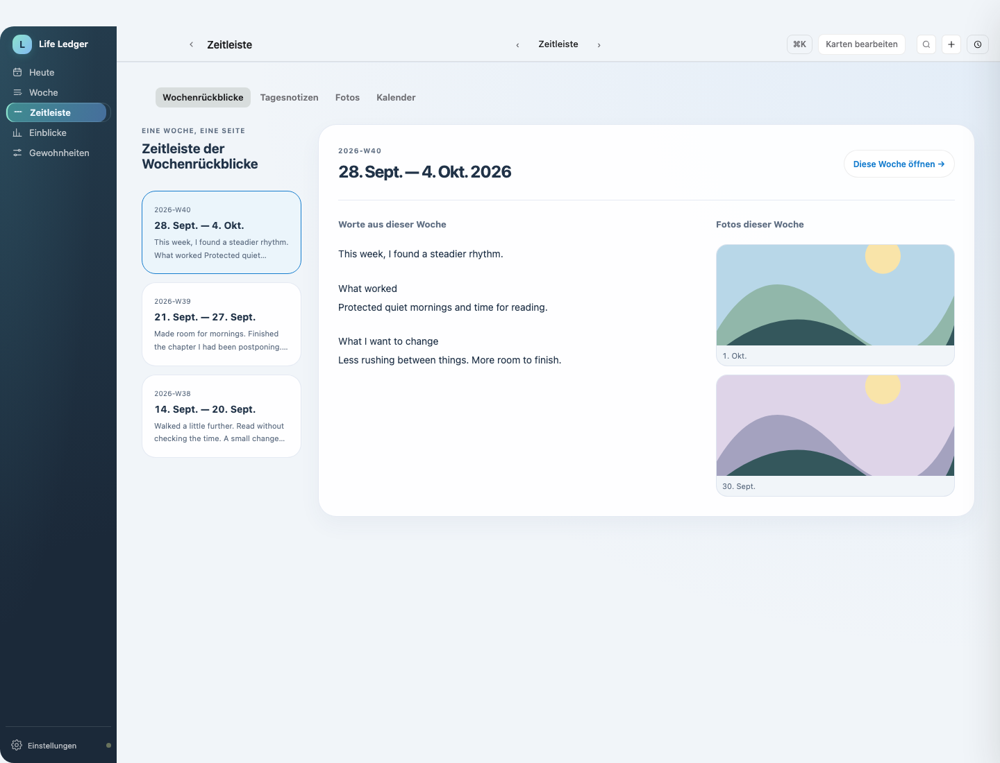

**Aktuelle Wochenansicht/gemeinsame Oberflächen:** [Aufnahme und mehrsprachige helle/dunkle Bilder](week-polish/index.html). Sieben-Tage-Auswahl, ursprüngliche Symbole, Ziele und Reflexion ohne verschachteltes Scrollen; Today nutzt dieselbe neue äußere Gestaltung. Fiktive Daten; noch nicht installiert oder visuell bestätigt.

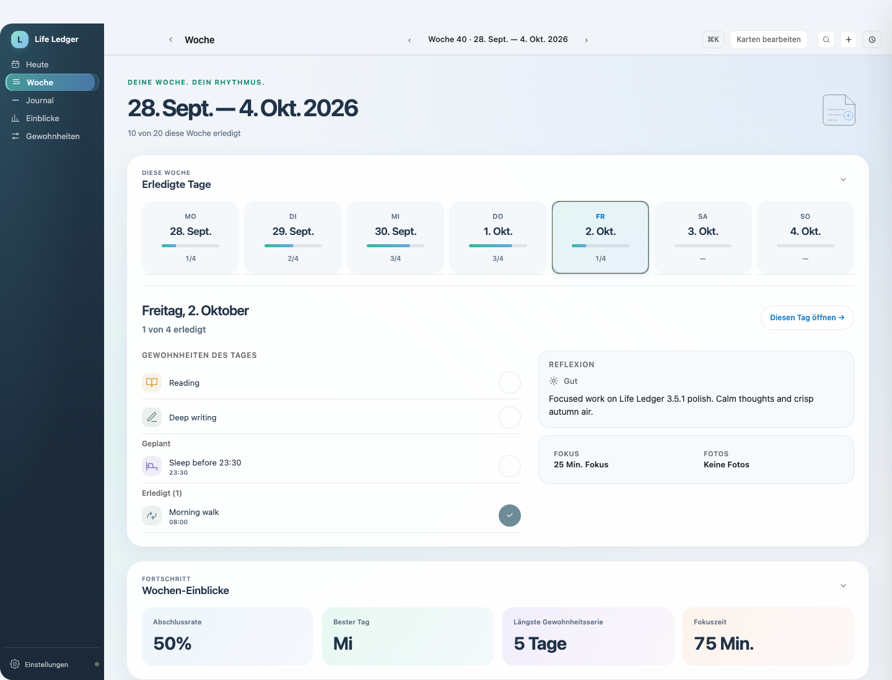

**Aktueller Prüfstand: Wetter und Widget-Bibliothek.** [Echte Interaktionsaufnahme und helle/dunkle Ansichten](today-widgets/weather-gallery/index.html). Temperatur- und Zeitachsen mit Maus-/Tastatursteuerung; aktuelles Wetter bleibt separat. Alle 11 vorhandenen Widgets stehen im Katalog, nicht hinzugefügte Karten belegen keinen Platz im Bearbeitungsraster. Noch keine installierte Veröffentlichung; Stimmung und Monats-Heatmap folgen später.

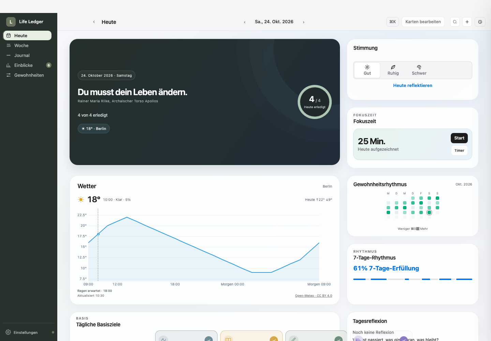

**Optionaler Widget-Prüfstand:** Stimmung, achtstufige Gewohnheits-Heatmap, lokale Foto/GIF/Videowand und stündliches Wetter; einheitliche S/M/L-Querformate plus quadratisches L. Neue Widgets sind zunächst ausgeblendet; bestehende Layouts bleiben erhalten. [Größen und Grenzen](today-widgets/README.md). Das Wetter im Bild ist simuliert, nicht live. Noch nicht paketiert oder vom Nutzer visuell bestätigt.

[Echte Bearbeitungsaufnahme ansehen](today-widgets/edit-cards/index.html): feste Karten im Normalmodus, karteneigene Einstellungen nur beim Bearbeiten, vollständiger Monat und kleine Heatmap-Punkte.

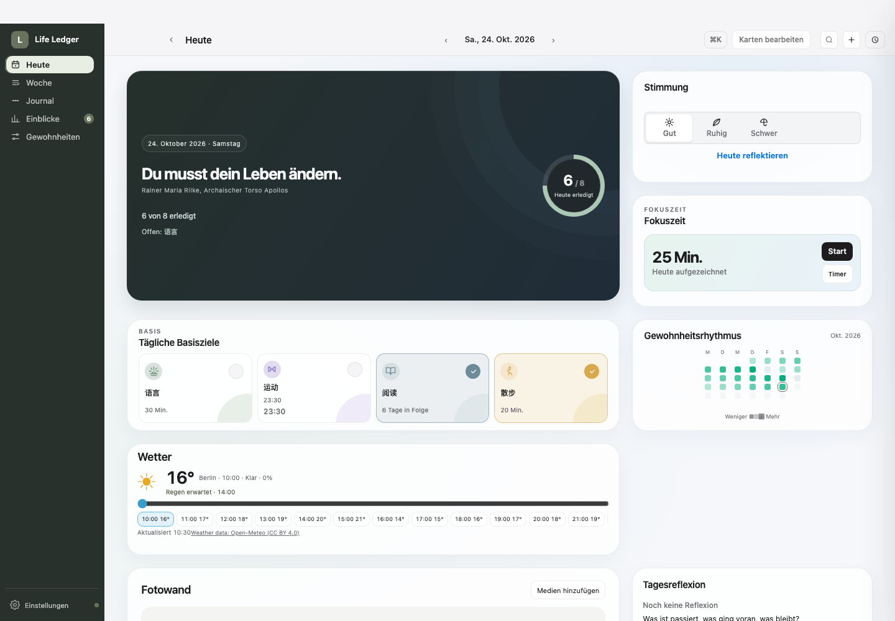

### Heute: planen und reflektieren

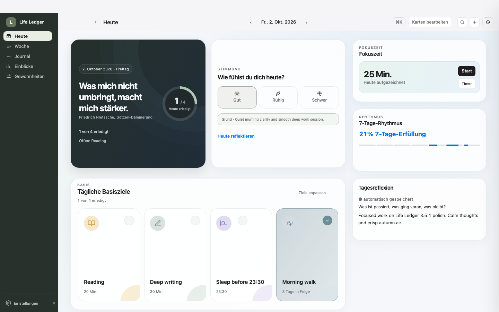

Heute 2.0 führt die modulare Widget-Plattform ein: ein responsives 12-Spalten-Raster mit Übersicht, Gewohnheiten, Kalender, Fokus, Fotos, Reflexion und Kontext, diskreten Größen S, M und L mit jeweils eigener Inhaltshierarchie, direktem Drag-and-Drop ohne Easing, Tastaturnavigation und Transaktions-Undo.

**Heute-Prüfstand:** Die Desktop-Ansicht verwendet die Web-Farben und vorhandenen Symbole. S zeigt eine priorisierte Gewohnheit, M vier Gewohnheiten und L die vollständige horizontale Liste. Ein Klick auf die Kachel markiert sie als erledigt. Die Screenshots stammen aus einem isolierten Headless-Browser mit fiktiven Daten; dieser Stand ist noch nicht paketiert oder vom Nutzer visuell bestätigt.

### Tagesrückblick

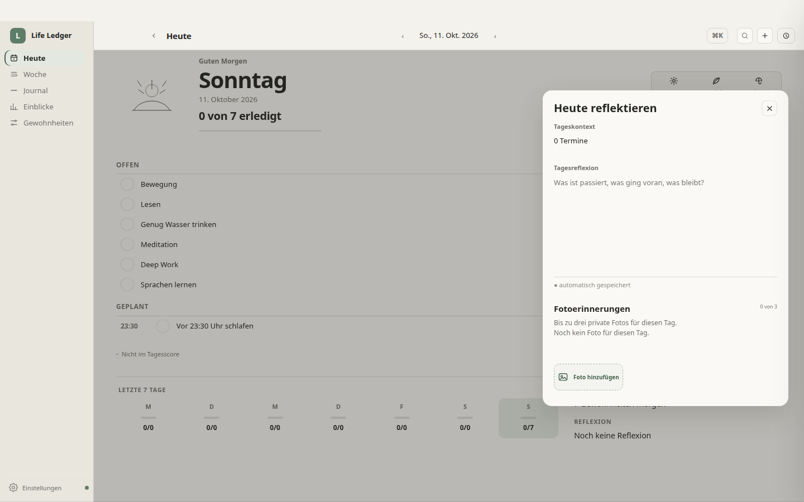

Öffne einen vergangenen oder den aktuellen Tag, um Gewohnheiten, Stimmung und Notizen zu ergänzen, ohne den Monat zu verlassen.

### Woche: Vorhaben und Rückblick

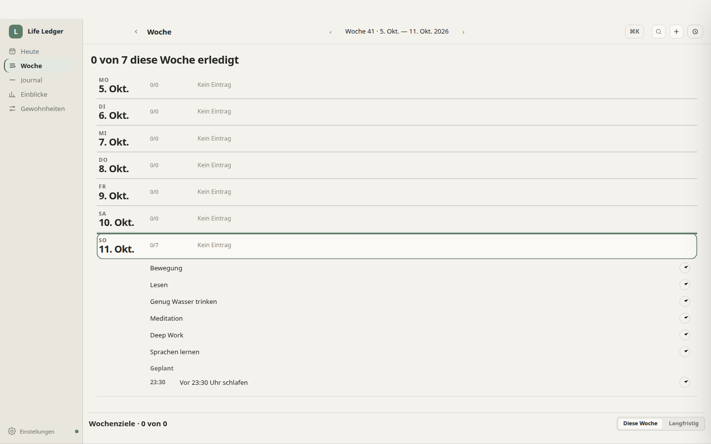

Erledigte Wochenziele bleiben als sichtbarer Fortschritt erhalten. Der Rückblick bietet ausreichend Raum für zusammenhängende Gedanken.

### Monatsrückblick: ein geschriebener Monat

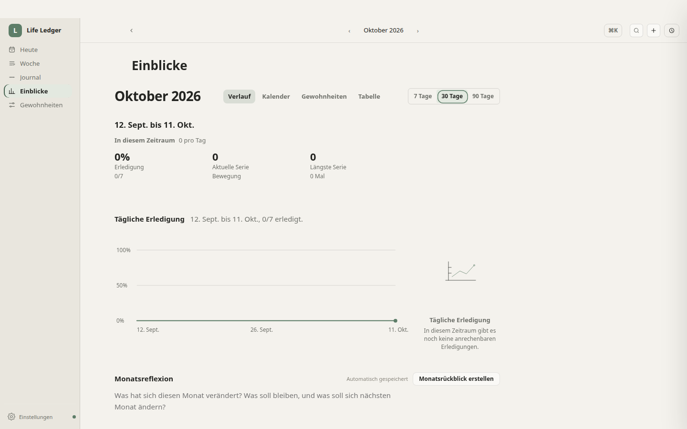

Der Monat beginnt mit einer 7/30/90-Tage-Erledigungsquote, Serien und einem Trend, danach die Reflexion. Gewohnheitswerte bleiben im Inspektor. Heute ist zweispaltig, die Zeitleiste legt die Journalseite neben den Monat. Bis zu drei private Fotos eines Tages bleiben auf diesem Gerät.

### Fokus: sehen, wohin die Zeit geflossen ist

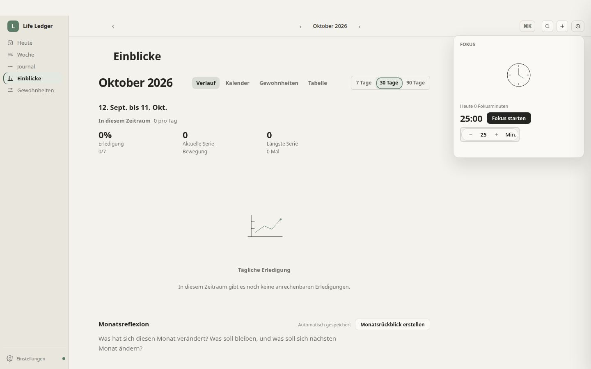

Vergleiche Fokusminuten nach Thema und erkenne deinen Rhythmus in einer Monats-Heatmap – ohne Fortschritt auf Session-Zahlen zu reduzieren.

### Zeitleiste: gelebte Tage wiedersehen

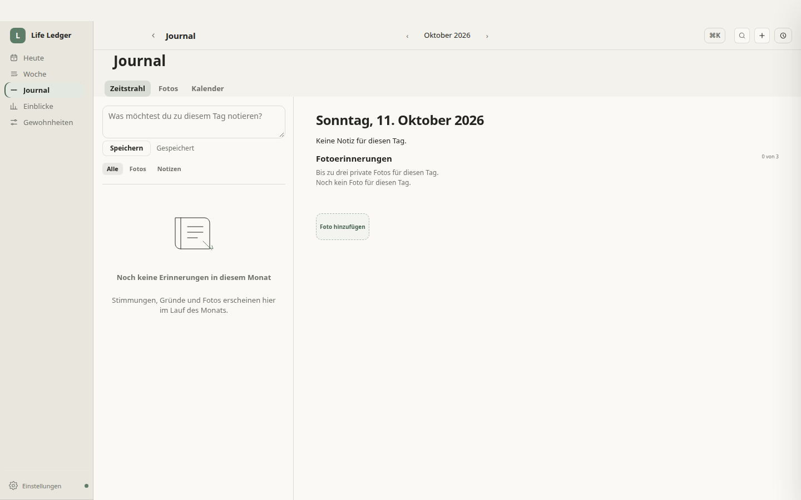

Durchlaufe eine private Chronik aus Stimmungen, Gründen, Journal-Kontext und komprimierten Fotoerinnerungen. Beispieldaten und Bild sind vollständig fiktiv.

### Gewohnheiten: Regeln dürfen sich entwickeln

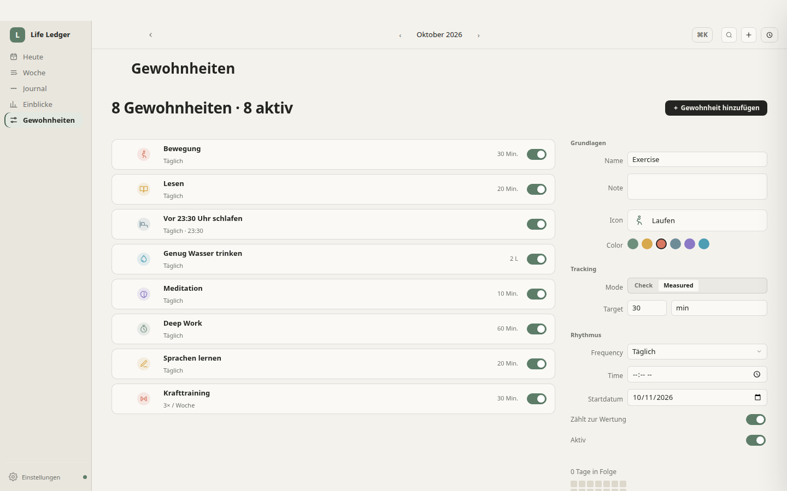

Gewohnheiten können täglich, wöchentlich oder monatlich gelten, in die Tageswertung einfließen oder davon ausgenommen werden und sich ab einem gewählten Datum ändern, ohne die Historie umzuschreiben.

## Mobil

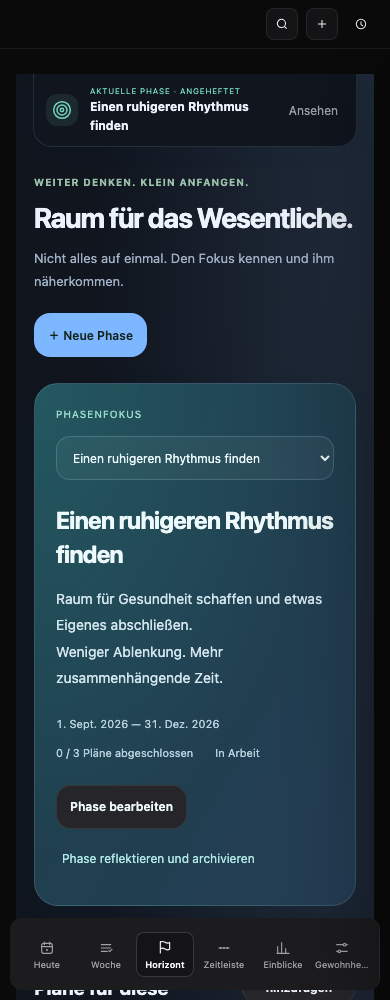

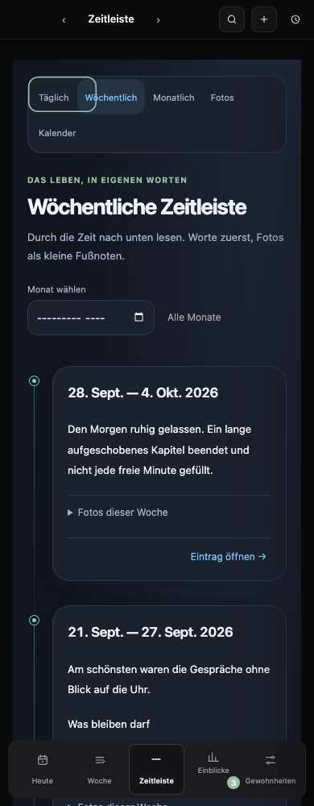

Die mobile Oberfläche verwendet eine feste Navigation am unteren Rand und macht den Tagesrückblick zu einem fokussierten, nahezu bildschirmfüllenden Bereich.

<table>
  <tr>
    <td width="33%">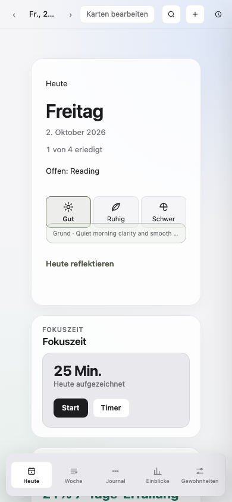</td>
    <td width="33%">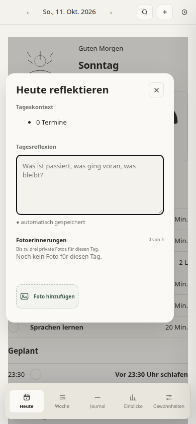</td>
    <td width="33%">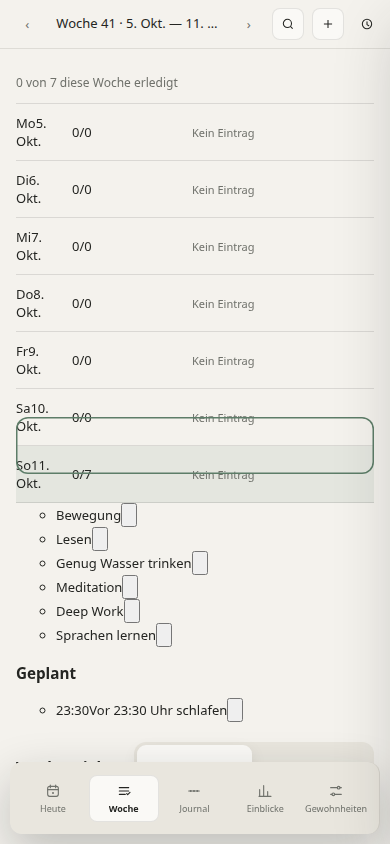</td>
  </tr>
  <tr>
    <td align="center"><strong>Heute</strong></td>
    <td align="center"><strong>Tagesrückblick</strong></td>
    <td align="center"><strong>Woche</strong></td>
  </tr>
  <tr>
    <td width="33%">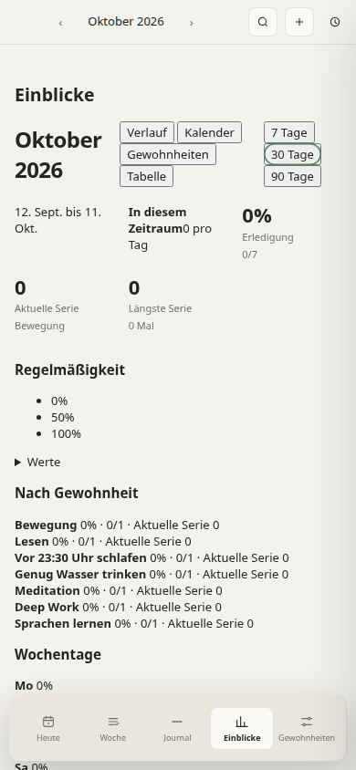</td>
    <td width="33%">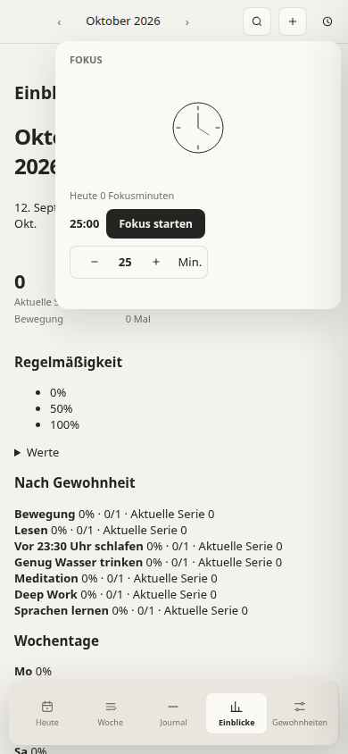</td>
    <td width="33%">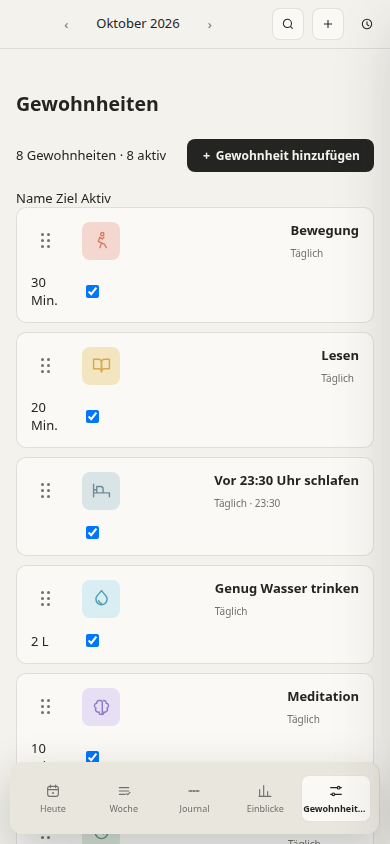</td>
  </tr>
  <tr>
    <td align="center"><strong>Rückblick</strong></td>
    <td align="center"><strong>Fokus</strong></td>
    <td align="center"><strong>Gewohnheiten</strong></td>
  </tr>
</table>

  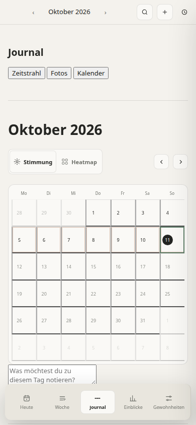

<strong>Zeitleiste</strong> · Stimmung, Kontext und Fotoerinnerungen bleiben auch auf kleinen Bildschirmen gut lesbar.

## Weiter

- [Life Ledger jetzt auf Deutsch verwenden](https://zubin-li.github.io/life-ledger-deep-review/?mode=local&lang=de)
- [Auf Cloudflare selbst hosten](self-hosting.md)
- [Cloudflare Access konfigurieren](cloudflare-access.md)
