# Life Ledger Produktüberblick

[English](SHOWCASE.md) · [简体中文](SHOWCASE.zh-CN.md) · [Deutsch](SHOWCASE.de-DE.md) · [Zurück zur README](../README.de-DE.md)

Life Ledger 2.0 macht Heute zu einem Karten-Arbeitsbereich und gestaltet alle Seiten neu. Alle Screenshots stammen aus dem fiktiven dreimonatigen Beispiel-Arbeitsbereich der lokalen Version.

## Desktop

### Heute: deine Karten

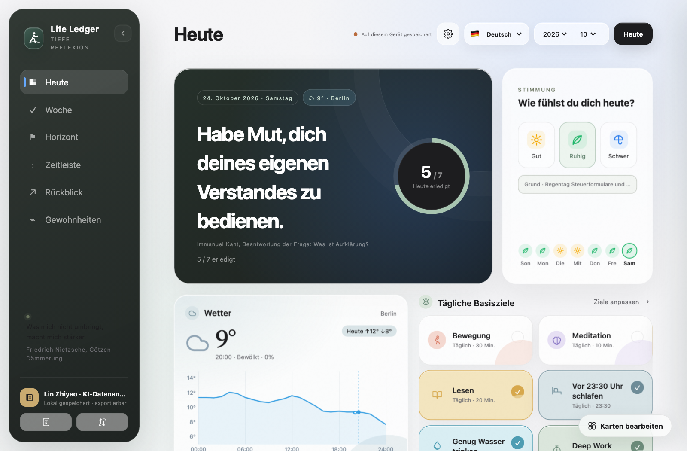

Wetter, Stimmung, Grundlagen, Heatmap, Fokus und mehr – jeweils als Karte. Zitat und Stimmungsfrage bleiben oben fest.

### Karten bearbeiten und Bibliothek

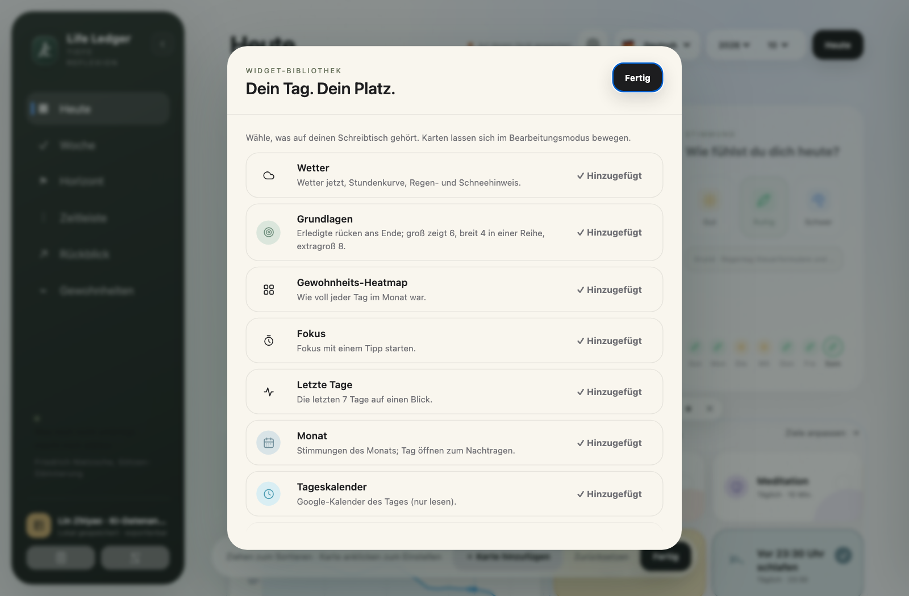

Im Bearbeitungsmodus lassen sich Karten ziehen, skalieren, einstellen oder entfernen; die Bibliothek fügt neue hinzu, auch eine zweite Fotowand.

### Woche

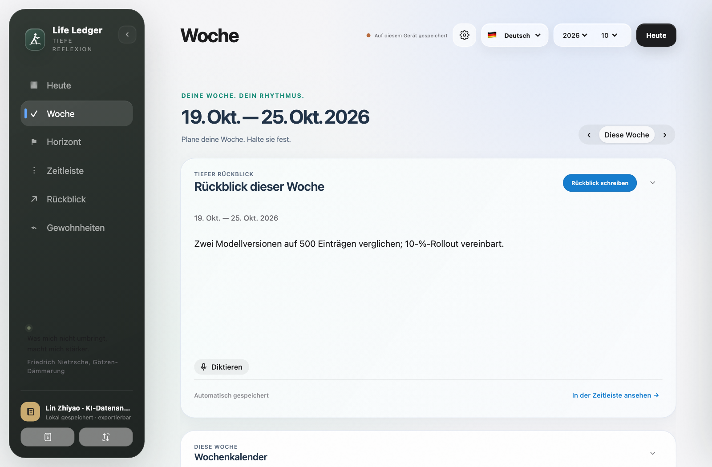

Wochenrückblick, Erledigtes und Ziele auf einer ruhigen Seite, mit Spracheingabe für den Rückblick.

### Horizont

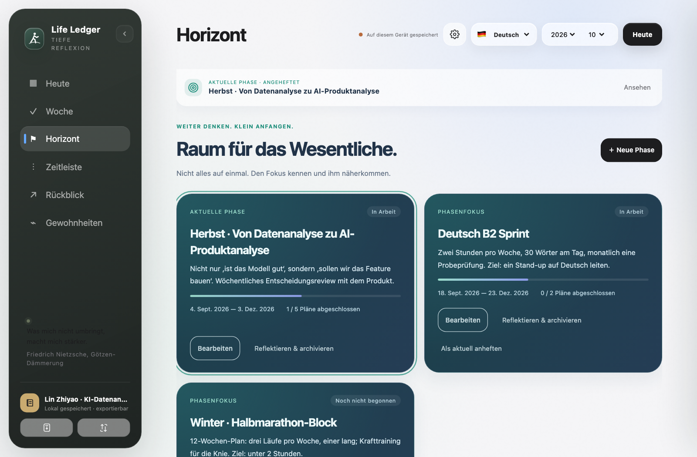

Langfristige Phasen nebeneinander: eine füllt die Seite, zwei teilen sie, mehr fließen ins Raster.

### Monatsrückblick

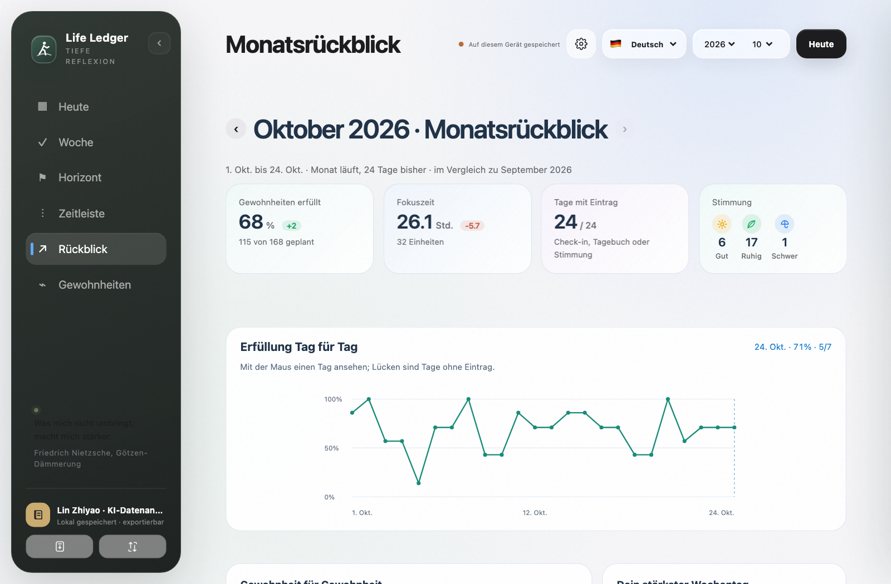

Ein Monat auf einmal: Erfüllung je Gewohnheit, Wochenrhythmus, Fokuszeit und schriftliche Reflexion.

### Zeitleiste

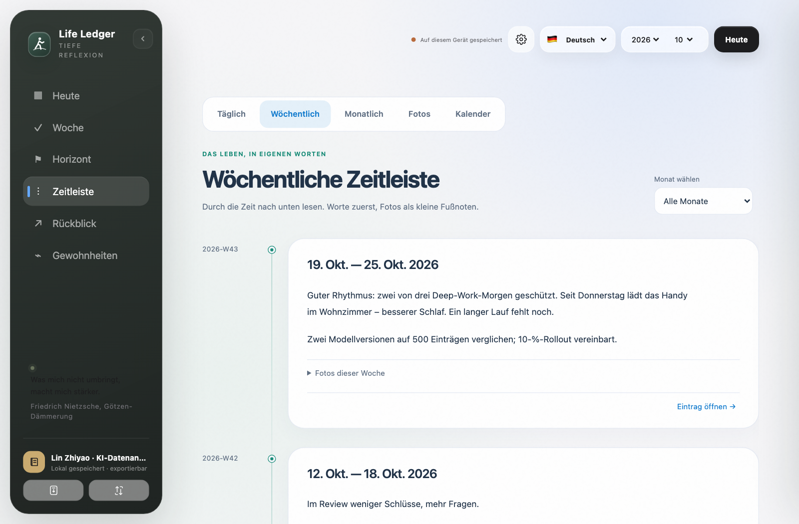

Tage, Wochen und Monate von oben nach unten; in Foto- und Kalenderansicht lässt sich jeder Tag bearbeiten.

### Gewohnheiten

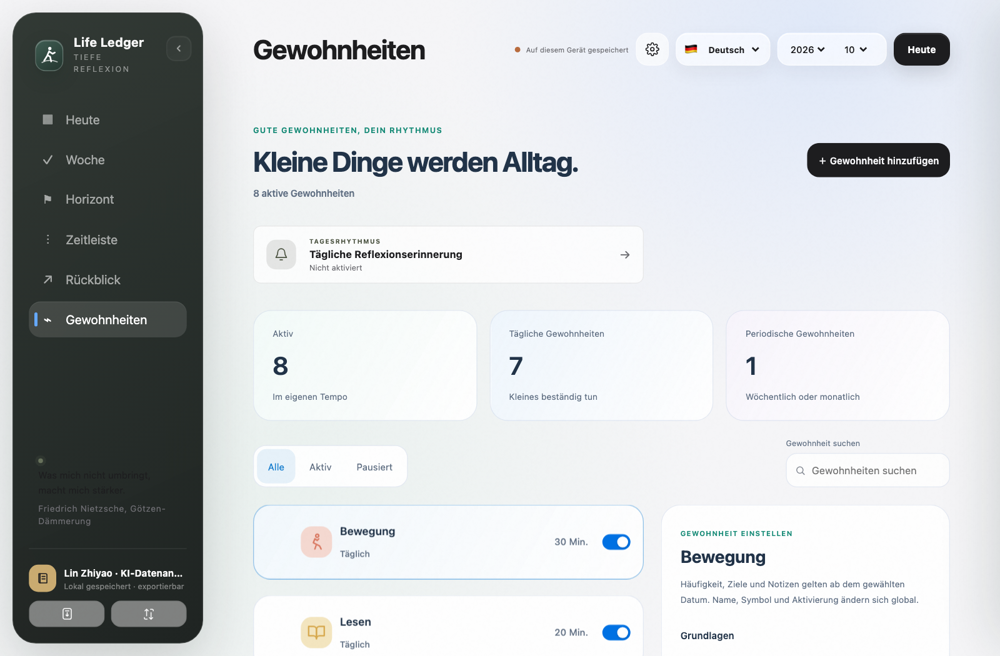

Ziele, Farben, Symbole und Häufigkeit (täglich, wöchentlich, monatlich) für jede Gewohnheit.

## Smartphone

<table>
  <tr>
    <td width="33%">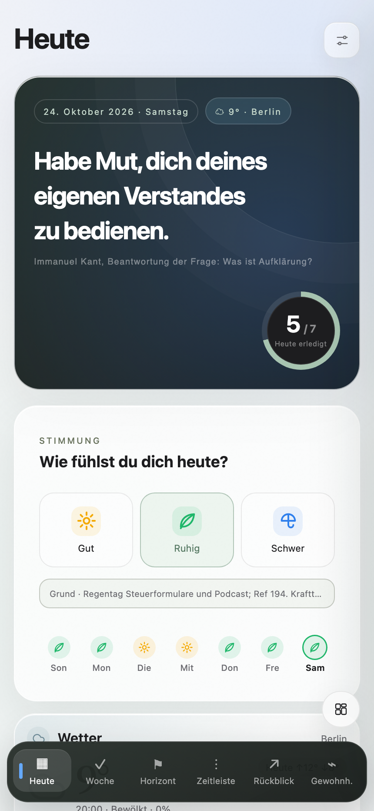</td>
    <td width="33%">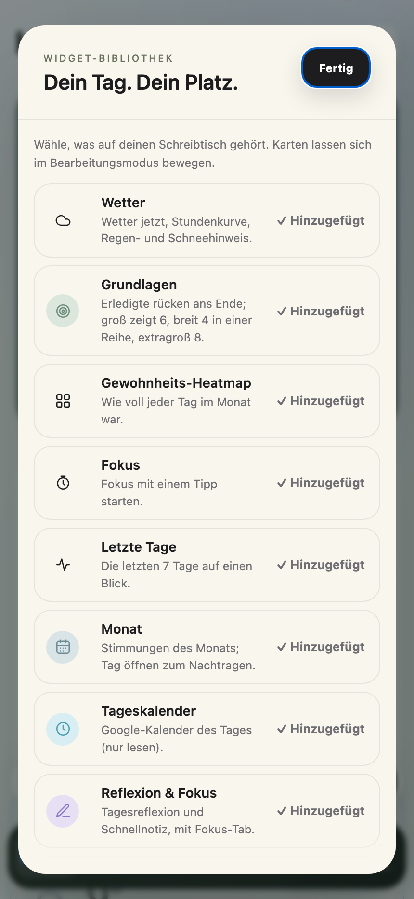</td>
    <td width="33%">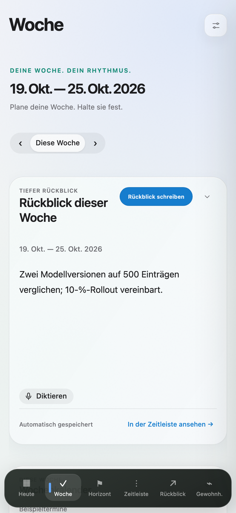</td>
  </tr>
  <tr>
    <td><strong>Heute: deine Karten</strong></td>
    <td><strong>Karten bearbeiten und Bibliothek</strong></td>
    <td><strong>Woche</strong></td>
  </tr>
  <tr>
    <td width="33%">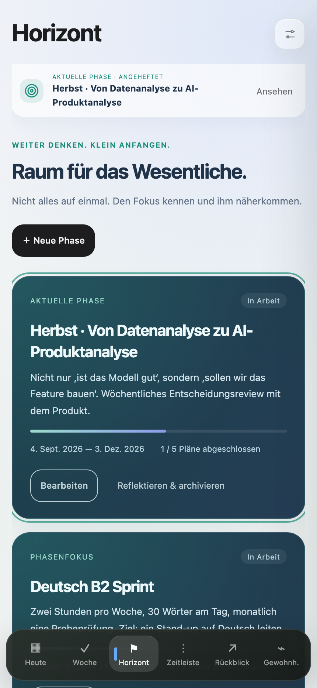</td>
    <td width="33%">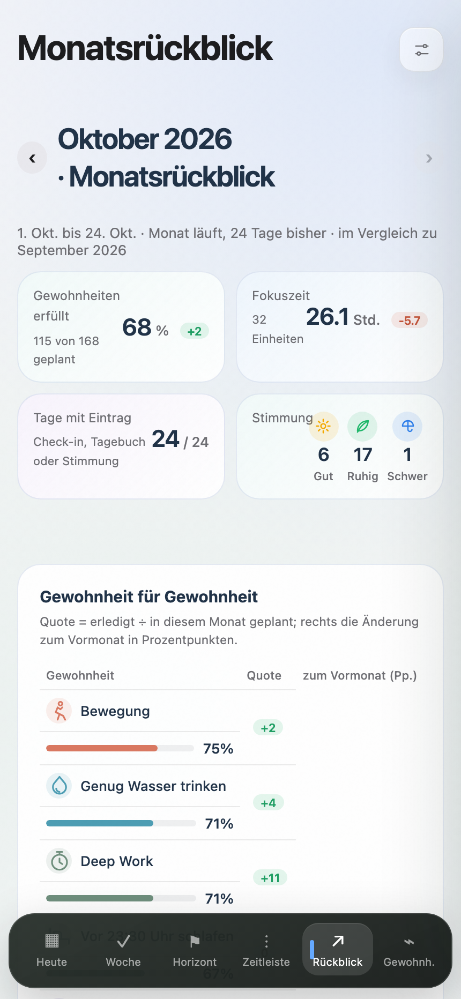</td>
    <td width="33%">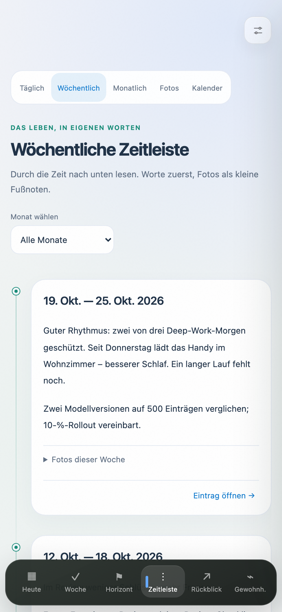</td>
  </tr>
  <tr>
    <td><strong>Horizont</strong></td>
    <td><strong>Monatsrückblick</strong></td>
    <td><strong>Zeitleiste</strong></td>
  </tr>
  <tr>
    <td width="33%">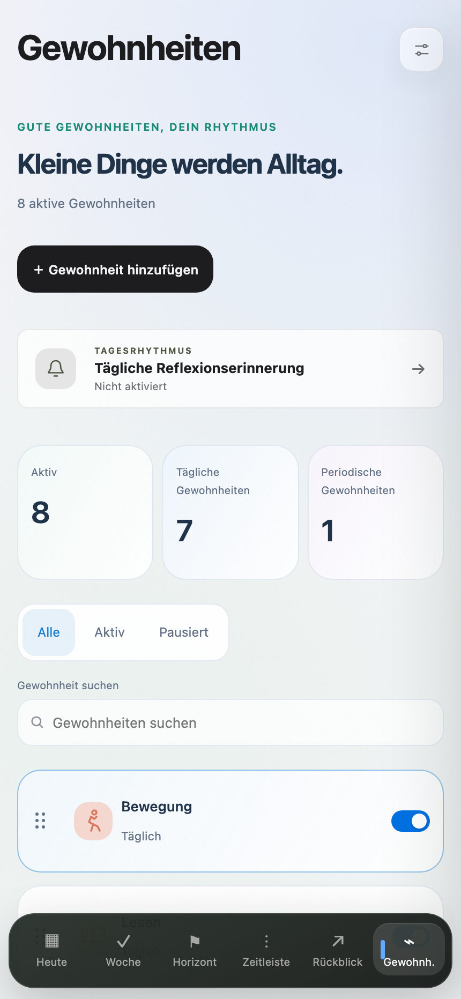</td>
  </tr>
  <tr>
    <td><strong>Gewohnheiten</strong></td>
  </tr>
</table>
