# Life Ledger product showcase

[English](SHOWCASE.md) · [简体中文](SHOWCASE.zh-CN.md) · [Deutsch](SHOWCASE.de-DE.md) · [Back to README](../README.md)

Life Ledger 2.0 turns Today into a card workspace and redesigns every page. All screenshots use the fictional three-month sample workspace that the local edition opens with.

## Desktop

### Today: your cards

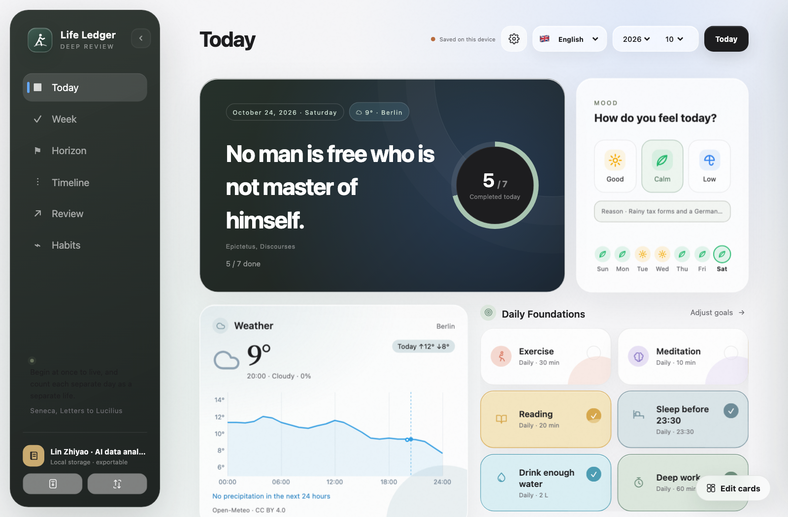

Weather, mood, daily foundations, heatmap, focus and more — each a card. The quote and mood check-in stay fixed at the top.

### Edit cards and the card library

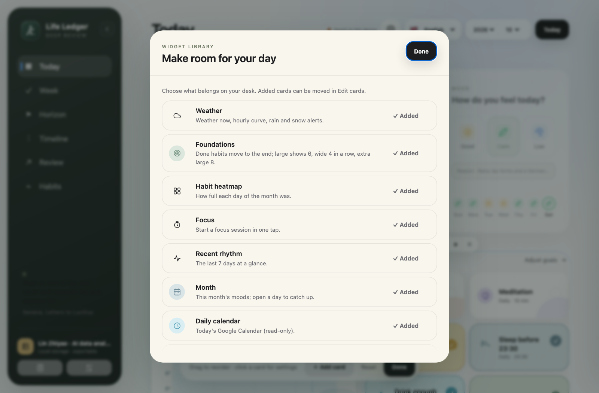

In edit mode cards can be dragged, resized, configured or removed; the library adds new ones, including a second photo wall.

### Week

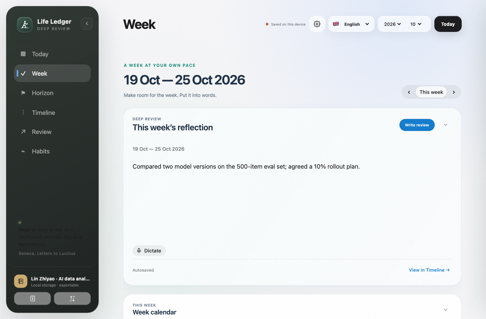

The week's review, what got done and the goals in one calm page, with voice input for the review.

### Horizon

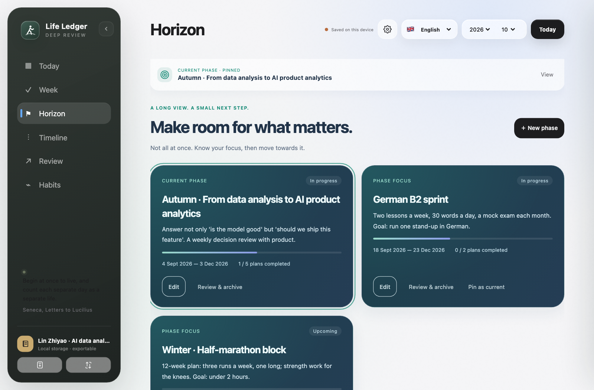

Long-term phases side by side: one phase fills the page, two share it, more flow into a grid.

### Monthly review

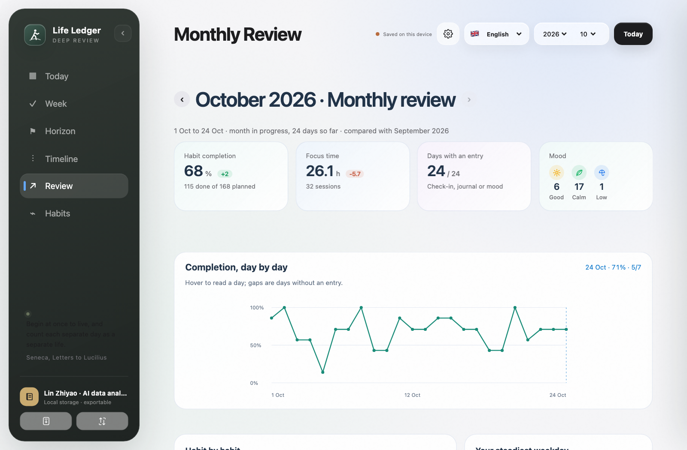

One month at a time: completion per habit, rhythm across the week, focus time and a written reflection.

### Timeline

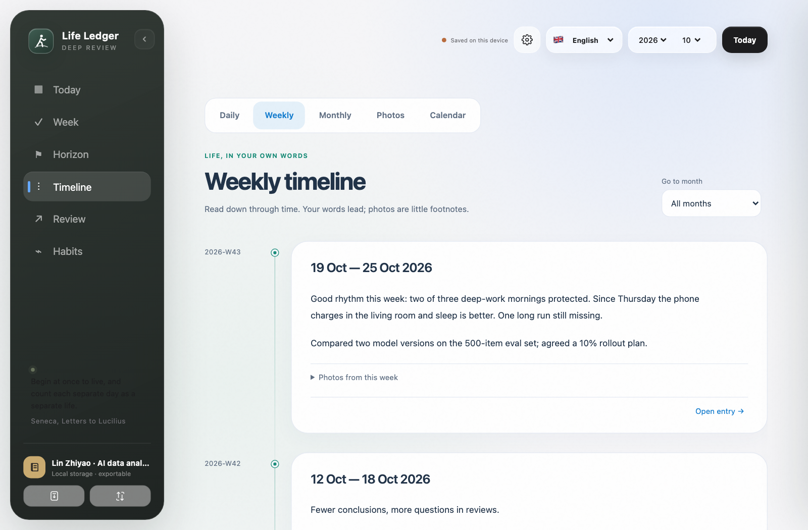

Days, weeks and months read downward; the photo and calendar views open any day for editing.

### Habit settings

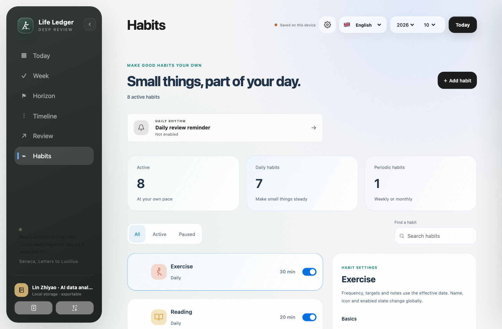

Targets, colors, icons and frequency (daily, weekly, monthly) for every habit.

## Mobile

<table>
  <tr>
    <td width="33%">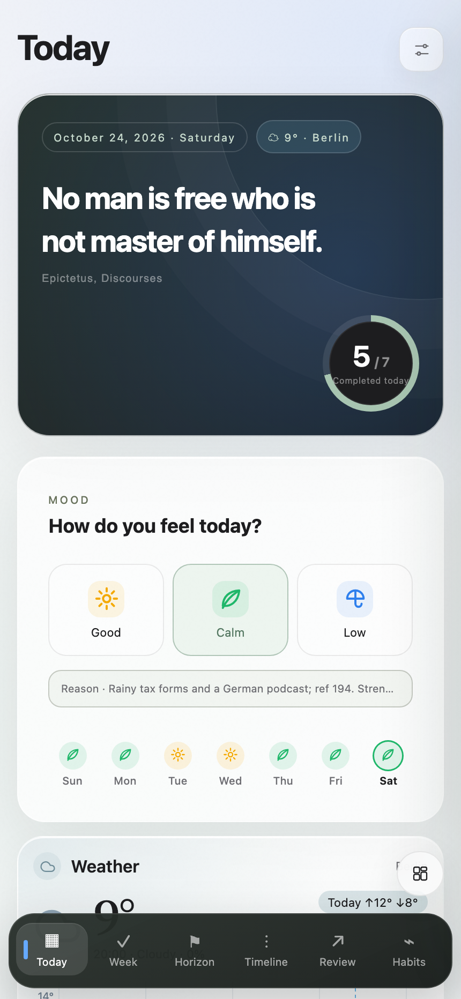</td>
    <td width="33%">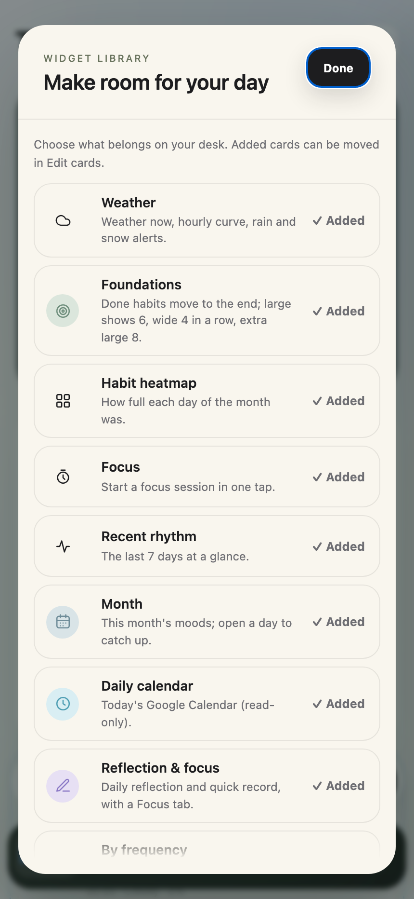</td>
    <td width="33%">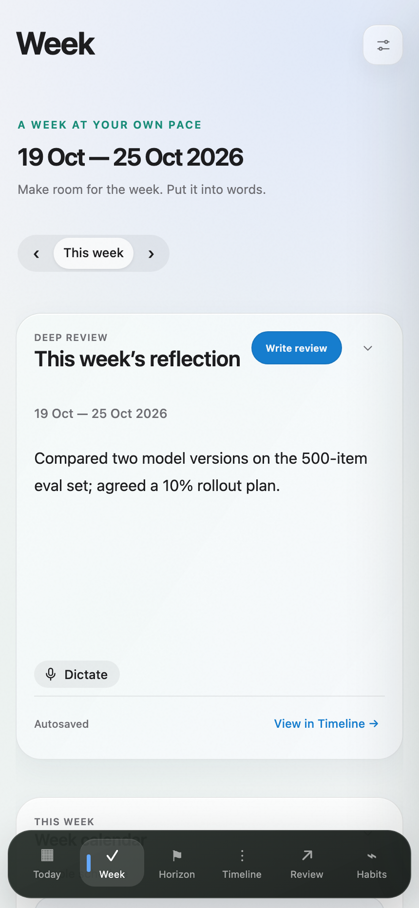</td>
  </tr>
  <tr>
    <td><strong>Today: your cards</strong></td>
    <td><strong>Edit cards and the card library</strong></td>
    <td><strong>Week</strong></td>
  </tr>
  <tr>
    <td width="33%">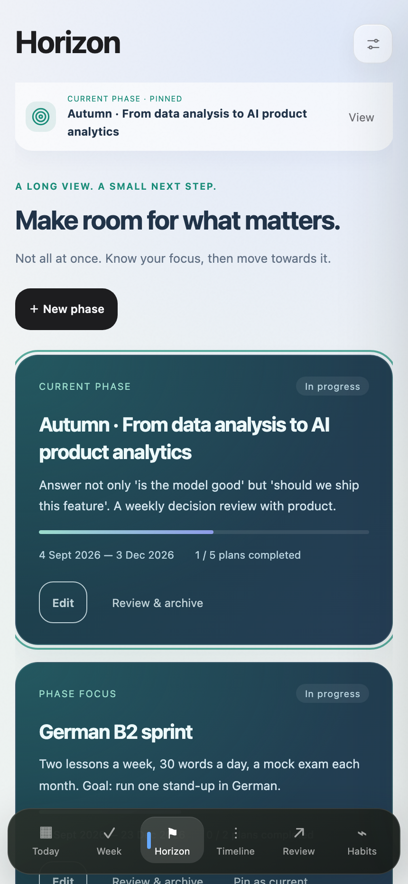</td>
    <td width="33%">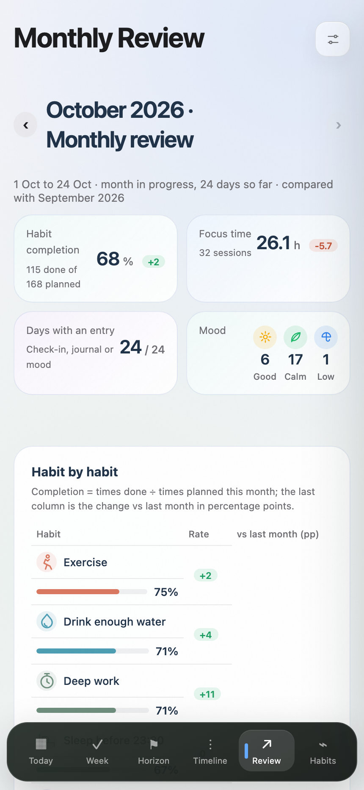</td>
    <td width="33%">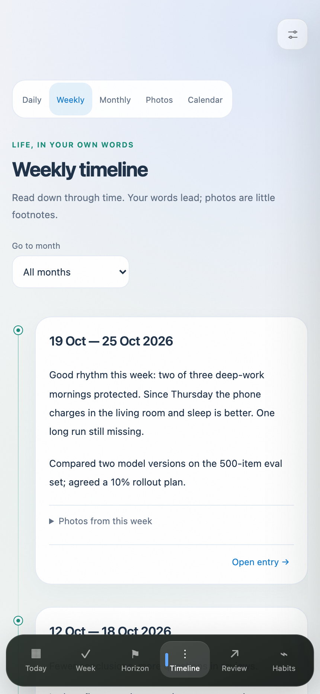</td>
  </tr>
  <tr>
    <td><strong>Horizon</strong></td>
    <td><strong>Monthly review</strong></td>
    <td><strong>Timeline</strong></td>
  </tr>
  <tr>
    <td width="33%">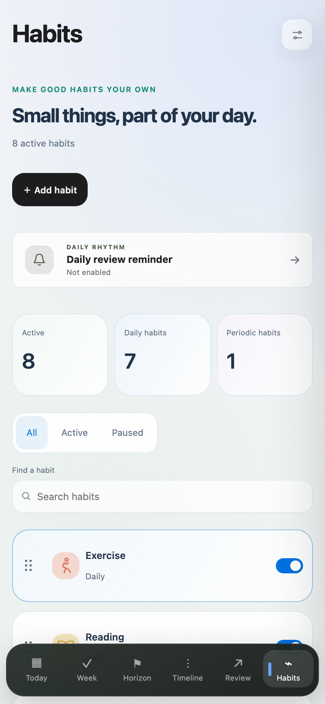</td>
  </tr>
  <tr>
    <td><strong>Habit settings</strong></td>
  </tr>
</table>
