# Life Ledger 产品展示

[English](SHOWCASE.md) · [简体中文](SHOWCASE.zh-CN.md) · [Deutsch](SHOWCASE.de-DE.md) · [返回 README](../README.zh-CN.md)

Life Ledger 2.0 把今日变成卡片工作台，并重新设计了所有页面。所有截图都来自本地版自带的三个月虚构示例数据。

## 桌面版

### 今日：你的卡片

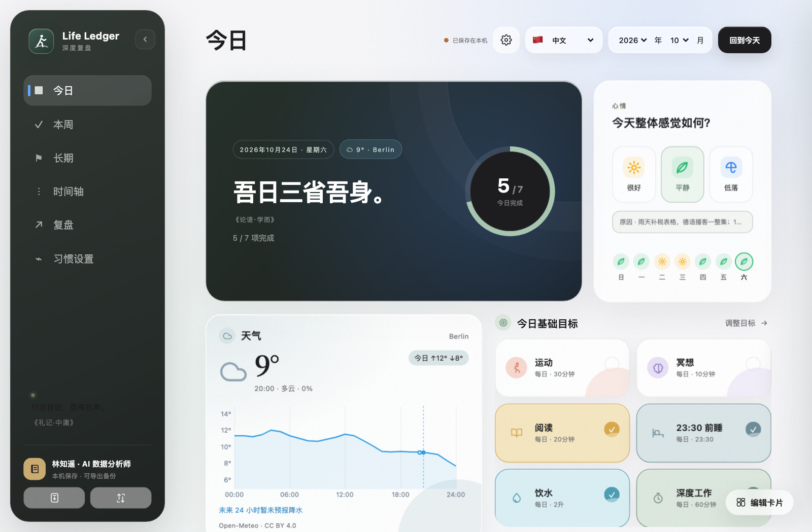

天气、心情、基础目标、热力图、专注等都是卡片；名言和「今天感觉如何」固定在顶部。

### 编辑卡片与卡片库

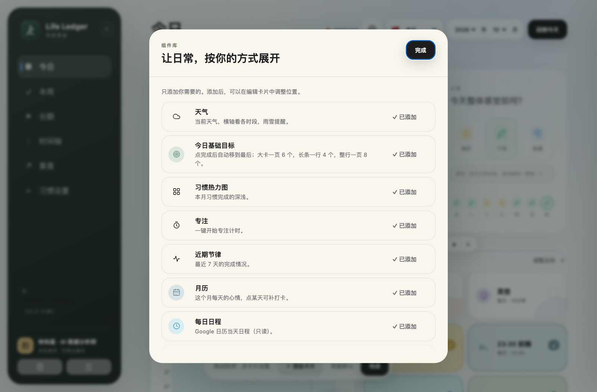

编辑模式下可以拖动、调整大小、设置或删除卡片；从卡片库添加新卡片，照片墙也可以加第二个。

### 本周

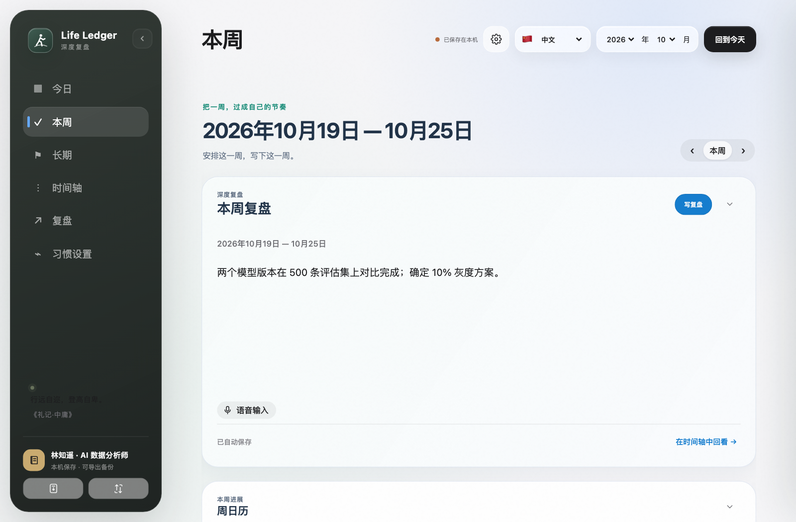

本周复盘、已完成的事和目标放在一页，复盘支持语音输入。

### 长期

长期阶段并排：一个阶段占满，两个平分，更多则排成网格。

### 月度复盘

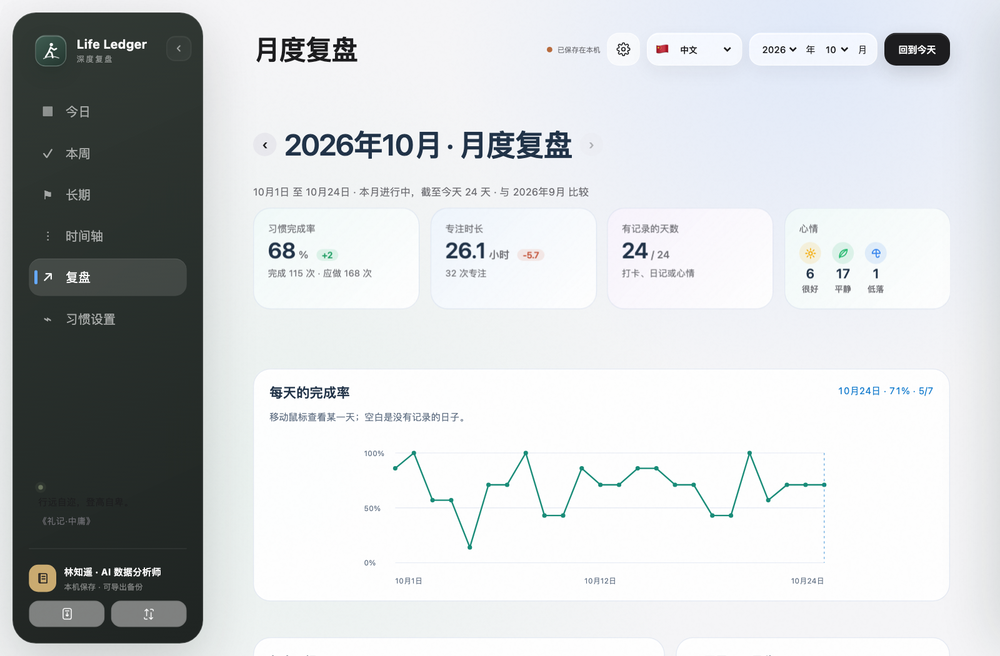

一次看一个月：每个习惯的完成情况、一周里的节奏、专注时间和文字复盘。

### 时间轴

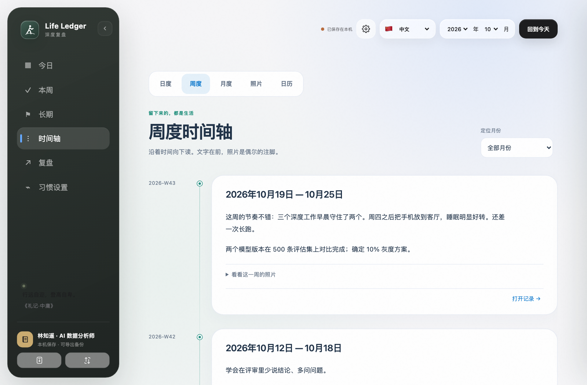

按日、周、月向下阅读；照片和日历视图里任何一天都能打开编辑。

### 习惯设置

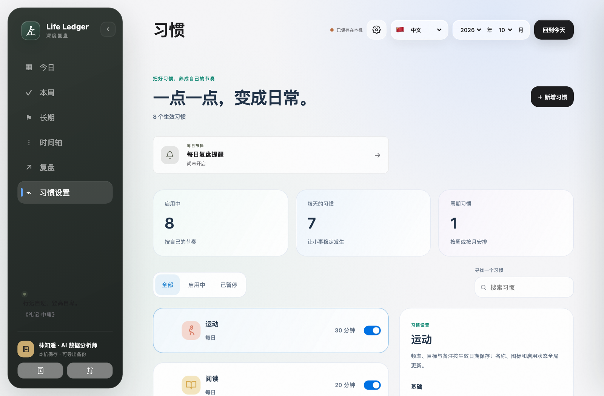

每个习惯的目标、颜色、图标和频率（每日/每周/每月）。

## 手机版

<table>
  <tr>
    <td width="33%">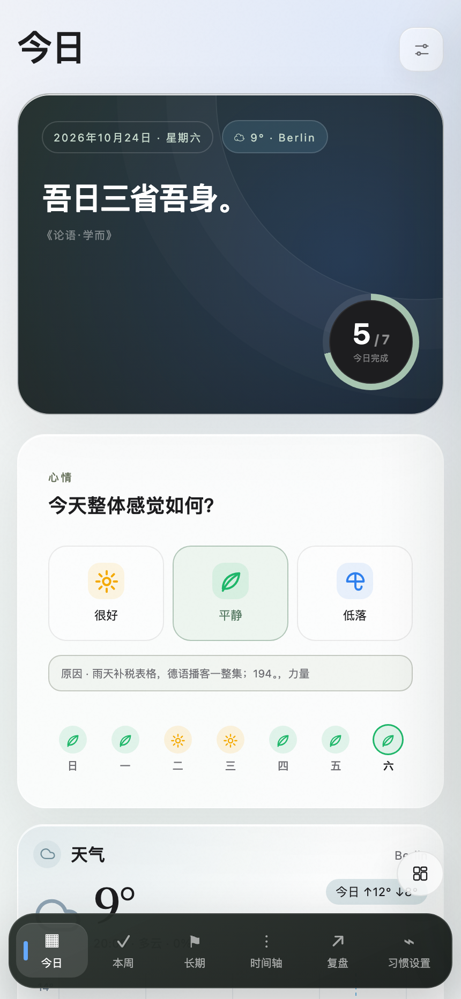</td>
    <td width="33%">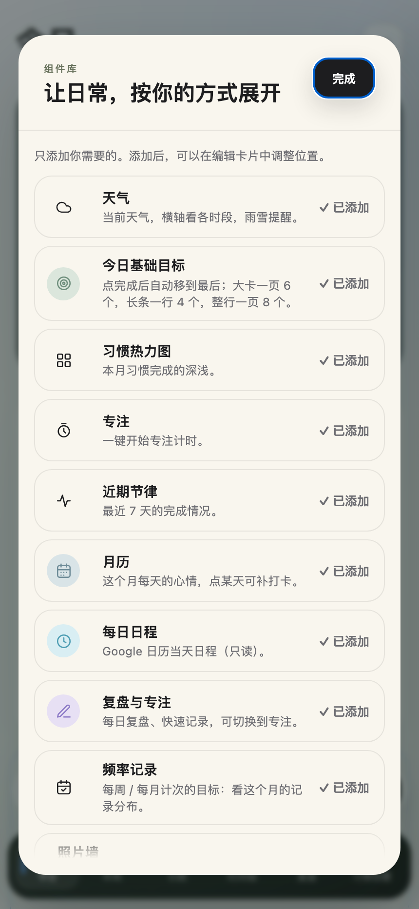</td>
    <td width="33%">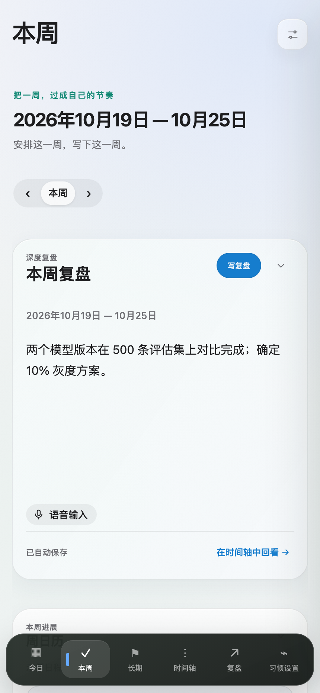</td>
  </tr>
  <tr>
    <td><strong>今日：你的卡片</strong></td>
    <td><strong>编辑卡片与卡片库</strong></td>
    <td><strong>本周</strong></td>
  </tr>
  <tr>
    <td width="33%">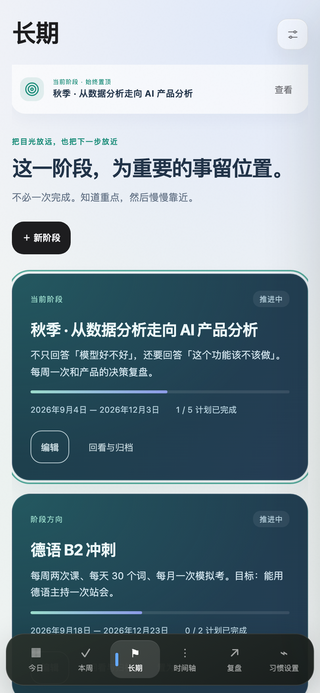</td>
    <td width="33%">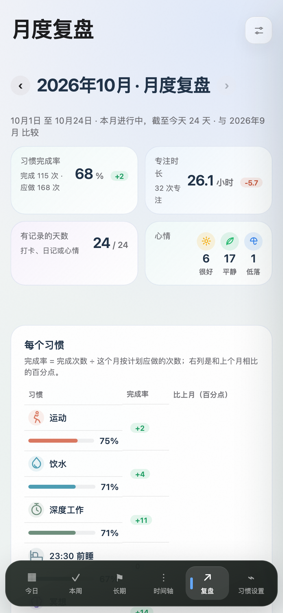</td>
    <td width="33%">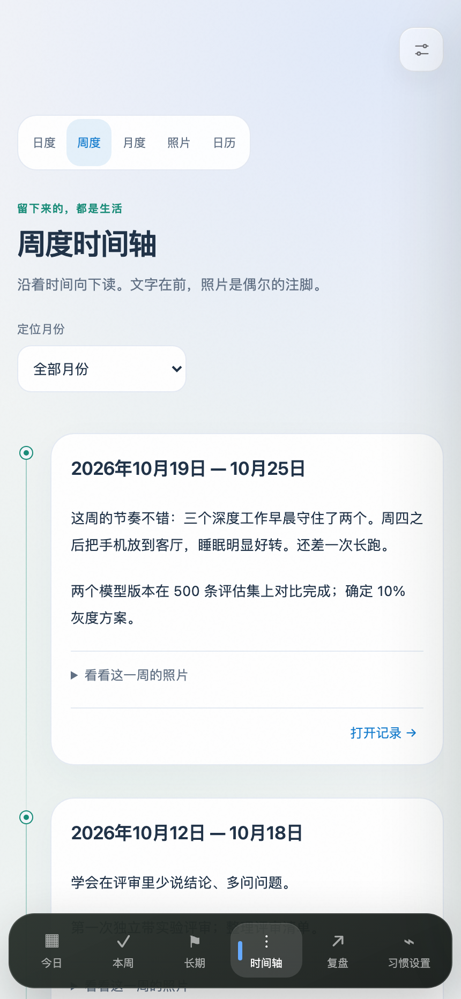</td>
  </tr>
  <tr>
    <td><strong>长期</strong></td>
    <td><strong>月度复盘</strong></td>
    <td><strong>时间轴</strong></td>
  </tr>
  <tr>
    <td width="33%">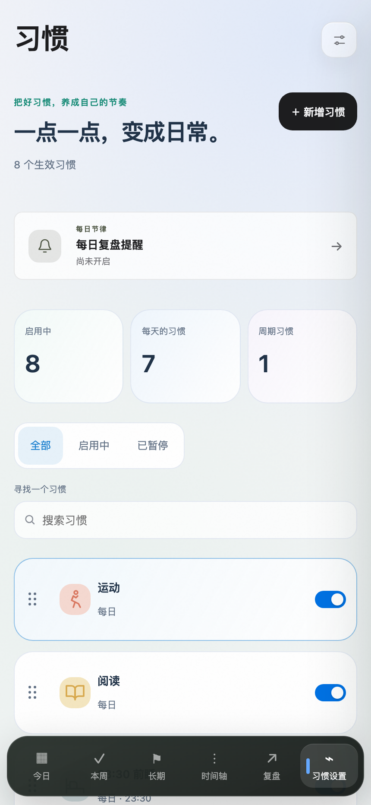</td>
  </tr>
  <tr>
    <td><strong>习惯设置</strong></td>
  </tr>
</table>
