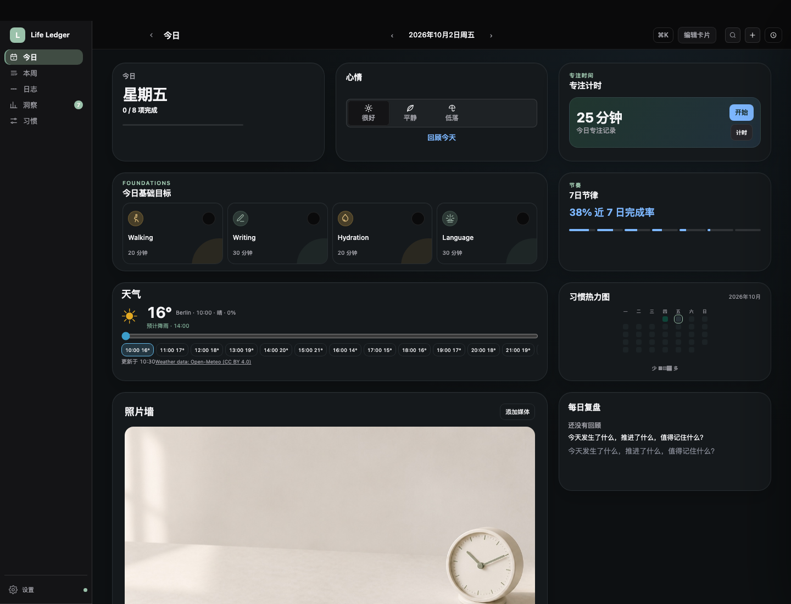

# Today：组件与尺寸确认

这是**真实桌面页面的功能检查点**，不是另一套 mockup，也尚未打包或替换已安装的 App。截图由隔离的无界面浏览器生成，使用虚构习惯与固定模拟天气；照片为项目已有的示例图。天气城市搜索与预报的真实接口均另行进行了 HTTP 200 连通检查。

## 尺寸如何变化

在 1440px 宽窗口中，欢迎卡与独立心情卡实测如下；其他卡片使用相同外框预设。宽度随窗口变化，窄窗口回到可读的单列布局，不硬塞桌面栅格。

| 预设 | 外框约尺寸 | 内容原则 |
|---|---|---|
| S | 387 × 180 | 只呈现优先内容；习惯显示优先项，热力图仍显示完整月份 |
| M | 793 × 180 | 横向展开；习惯显示 4 项，天气可浏览小时轴 |
| L · 横向 | 793 × 380 | 完整内容；习惯保留横向图标轨道，热力图仍为完整月份 |
| L□ · 方形 | 793 × 793 | 与横向 L 同宽，但保持正方形；适合照片墙、日历等，不靠放大字号填满空间 |

**同一预设必须是同样的外框，不等于每种内容都强行铺满。** 欢迎和心情可以分成两张独立卡；未添加独立心情时，仍保留原概览中的心情操作。

[打开四种尺寸的截图对照](index.html)

## 如何使用

1. 工具栏 **编辑卡片** → 才出现添加组件、拖动和尺寸操作；普通模式卡片固定。
2. 编辑时**点按卡片**打开它自己的设置面板（也可聚焦卡片按 Enter）；尺寸、显示与配色自动保存。Escape 只关闭面板，不取消编辑。天气城市在天气卡片自己的设置中选择。
3. 编辑中可以拖动排序，或选 S / M / L / L□；原有拖拉缩放、隐藏和撤销保留。按完成后固定卡片，配色和城市选项不会常驻卡片。
4. 新组件默认隐藏，不打乱已有布局。布局、组件尺寸、配色与天气城市保存到本机。

[查看真实操作录屏与分步骤截图](edit-cards/index.html)

### 习惯热力图

读取所选日期**完整自然月**的实际习惯记录，周一开头对齐，小色点按当天完成比例映射到 8 个深浅等级，未来日期淡显。S/M 色点 10px，L 12px；所有尺寸保留完整月份，不再按 14/42/84 天截断。在编辑卡片设置中可选翡翠绿、海洋蓝或红到蓝；配色跟随该组件的布局设置保存。悬停或键盘聚焦可读日期、完成数量和百分比；打卡后同步更新。

### 照片墙

复用现有 IndexedDB 存储工具，使用独立媒体库。支持 JPEG / PNG / WebP / GIF，以及浏览器能够播放的 MP4 / WebM / QuickTime。可以上一项、下一项、移除和循环播放；多项每 8 秒切换，视频静音循环。低动态 / 关闭动效时停止轮播与视频，GIF 显示静态首帧；组件离屏或窗口隐藏时暂停播放。

每个文件上限 50 MB，最多 20 项、合计 250 MB。原文件不修改。**当前只在本机保存，不包含在每日照片备份或云同步中；视频编码能否播放仍取决于系统 WebView。** 尚未在原生 macOS WebKit 中实测。

### 天气

手动设置城市后才查询，不自动获取定位。接入 [Open-Meteo 预报](https://open-meteo.com/en/docs) 和[地名搜索](https://open-meteo.com/en/docs/geocoding-api)，无新增依赖或 API key。城市与约 30 分钟缓存保存到本机；网络失败可显示已有预报。可拖动小时滑块、悬停或点击小时，查看未来 24 小时的温度、天气、降水概率与预计雨雪时间。

**雨雪提示是卡片内的天气预报提示，不是系统通知或官方恶劣天气警报。** 数据采用 Open-Meteo 的 CC BY 4.0 标注；正式商用前需要确认其服务方案。

## 实际截图

本检查点需由用户亲自确认视觉效果；自动测试通过不等于视觉获批。未改版本号、未提交、未发布、未安装。
